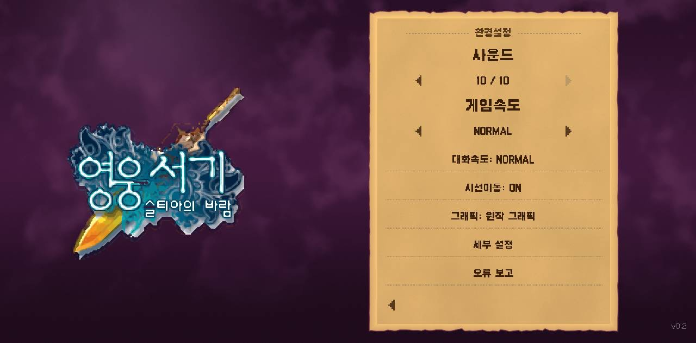
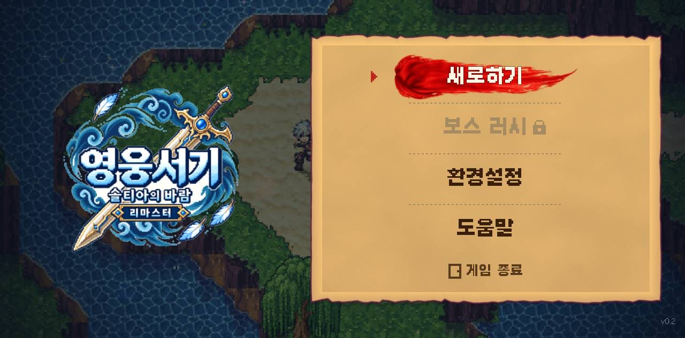
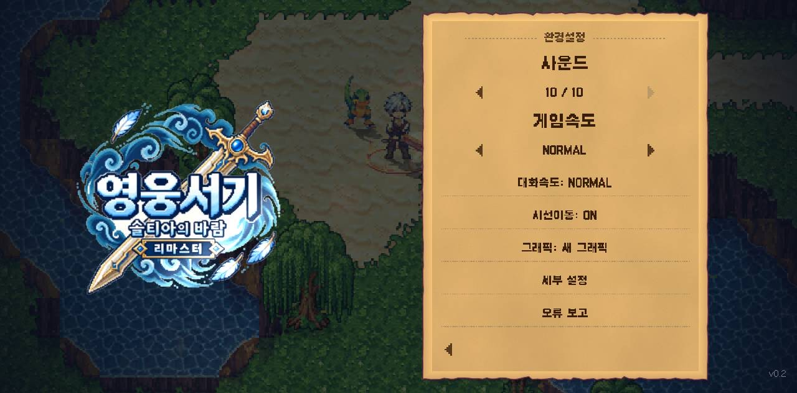
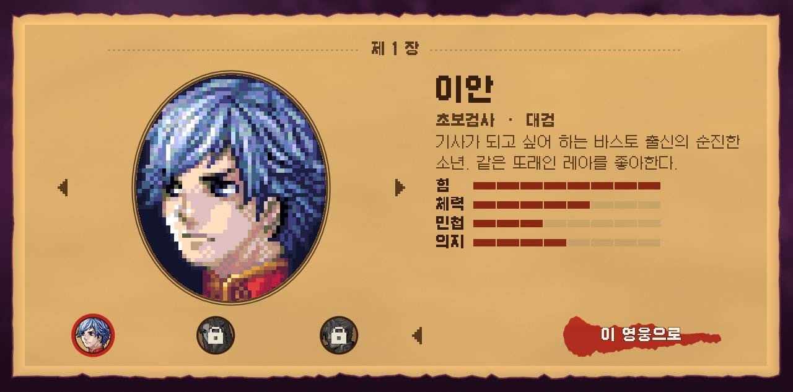
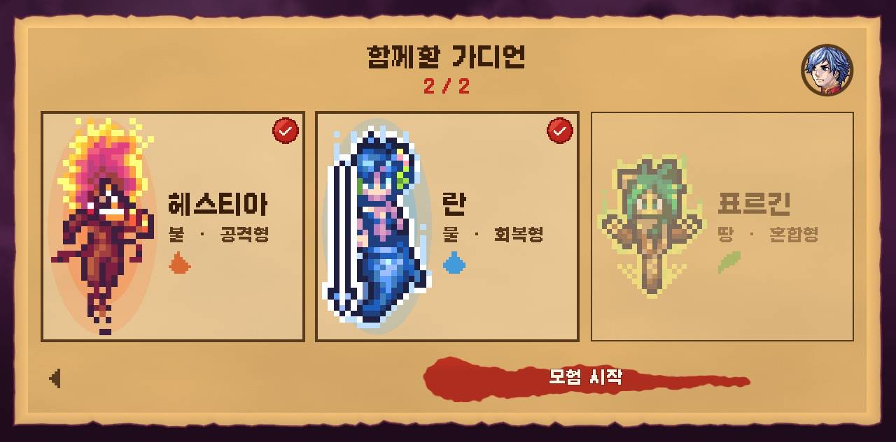

# hero-lord-web

**영웅서기: 솔티아의 바람 리마스터** (fan remaster by Nimdal, shipped as a Godot 4.6
Android APK) running in the browser.

- Live: https://lesanf.github.io/hero-lord-web/ (GitHub Pages, rebuilt from `main` by Actions; only the latest deployment is ever served)

## 원작 그래픽 / 리마스터 그래픽

The game ships both art sets. The page asks which one before it starts; the
choice is remembered, and the game's own 환경설정 switches at any time.

| 원작 그래픽 (2005, KTF) | 리마스터 그래픽 |
|---|---|
|  |  |
|  |  |

Deep links: [`?art=original`](https://lesanf.github.io/hero-lord-web/?art=original) ·
[`?art=remaster`](https://lesanf.github.io/hero-lord-web/?art=remaster).

### 게임 안에서 고를 수 있는 길

| | |
|---|---|
|  타이틀: 새로하기 · 보스 러시(잠김) · 환경설정 · 도움말 |  환경설정: 사운드 · 게임속도 · 대화속도 · 시선이동 · **그래픽** · 세부 설정 · 오류 보고 |
|  새로하기 → 영웅 선택 (제 1 장은 이안, 나머지는 잠김) |  함께할 가디언 2명 선택 → 모험 시작 (셋째는 잠김) |

## How it works

The APK contains no native game code. `libgodot_android.so` is the stock Godot
4.6 runtime; the game is compiled GDScript (`.gdc`) plus assets stored loose
under `assets/`, already imported for the GL Compatibility renderer. So the port
is a repack, not a rewrite:

```
APK ─unzip─▶ exported Godot project ─pack─▶ hero-lord.pck ─split─▶ 64 MB parts
                     +  web/override.cfg + web/web_shim.gd (web-only autoload)
official Godot 4.6 web template (godot.wasm, nothreads) + web/index.html ─▶ static site
```

| step | file | notes |
|---|---|---|
| inventory | `tools/inventory.py` | what is in the APK, no extraction |
| extract | `tools/extract_project.py` | `assets/` → `build/project/`, drops Android-only files |
| shrink | `tools/minify_json.py`, `tools/compress_audio.sh` | JSON whitespace (19 → 10 MB) and PCM → QOA audio inside the same `AudioStreamWAV` resources (80 → 16 MB, done by the Godot 4.6 binary itself, headless) |
| pack | `tools/pack_pck.py` | PCK v2 writer, stdlib only, `tools/test_pack_pck.py` round-trips it |
| assemble | `tools/build_web.py` | pulls the 9.5 MB web template out of the 1.25 GB official tpz with HTTP range requests (sha256 pinned), splits the PCK, writes `index.html` |
| all of it | `./build.sh game.apk` | ~25 s on a laptop; the site is 157 MB of game data + 38 MB of engine |

`web/index.html` starts downloading the parts immediately, shows the two art
cards while that runs, then hands the buffer to the engine with `preloadFile`
and starts it with `--main-pack … -- art=<choice>`. Single-threaded template, so
no COOP/COEP headers are needed and any static host works.

## Web-only shim

Nothing in the game is modified. `web/override.cfg` is packed next to
`project.binary` and registers one autoload, `web/web_shim.gd`, which:

- turns on `emulate_touch_from_mouse` (the in-game menus only listen to touch) and keeps the real left click away from the GUI, so every click reaches the game exactly once, through the same router Android uses
- labels every HUD button with its keyboard key
- adds `R` for auto-quest, the one HUD action the game left without a key
- forces Godot's web audio to stream playback (`default_playback_type.web = 0`); the default "sample" mode cannot drive the game's custom buses and effects, which came out as silence
- caps the new-game guardian pick at two (the game lets a third one through)
- writes the landing-page art choice (`art=original|remaster` user arg) into `user://options.json` as `new_art` before the game reads its options

| action | keys |
|---|---|
| move | W A S D / arrows |
| attack, talk | Space, Enter |
| strong attack | X |
| skill slots | 1, 3 |
| item | Q |
| cycle slot | E, Tab |
| map | M |
| menu | Esc |
| auto-quest | R (shim) |


## Build it yourself

```sh
./build.sh hero-lord-remaster-20261014-r24.apk          # downloads the template member from GitHub
./build.sh game.apk path/to/web_nothreads_release.zip   # or use a local template zip
python3 -m http.server -d build/web 8765                 # http://127.0.0.1:8765/
```

Requirements: Python 3.8+ and `curl`. The audio step downloads the official
Godot 4.6 binary into `build/godot/` (sha256 pinned) unless `GODOT=` points at
one. No editor project, no Node.

## Docs

- [01 · What is in the APK](docs/01-apk-analysis.md) — manifest, native libs, project layout, formats, with REA evidence ids
- [02 · What the scripts assume](docs/02-scripts-and-web-compat.md) — decompiled platform guards, input model, the shim decision, runtime evidence

## Deploy

Visitors: Cloudflare Web Analytics in JS-snippet mode (no cookies, no proxying;
the beacon token in `web/index.html` is public by design). Dashboard under the
Cloudflare account's Analytics & Logs → Web Analytics → `lesanf.github.io`.

`.github/workflows/pages.yml` downloads the APK from the `apk-r24` release, runs
`build.sh` and deploys `build/web/` to GitHub Pages. Each push to `main`
replaces the site; there is no second host and no preview deployments.

## Credits and legal

- Game: 영웅서기 (Heroes Lore) remaster by **Nimdal** (@0xnimdal), a fan game of
  the KTF-era original. All art, audio, scripts and data belong to their
  respective authors and are **not** covered by this repository's license.
- Engine: [Godot Engine](https://godotengine.org) 4.6, MIT.
- Analysis: [REA](https://github.com/morluto/rea) (JADX, CDP) and
  [GDRE Tools](https://github.com/GDRETools/gdsdecomp) for the decompiled scripts.

Tooling and docs here are MIT. The APK is attached to the `apk-r24` release
only as the build input; this repository's git history contains no game content.
