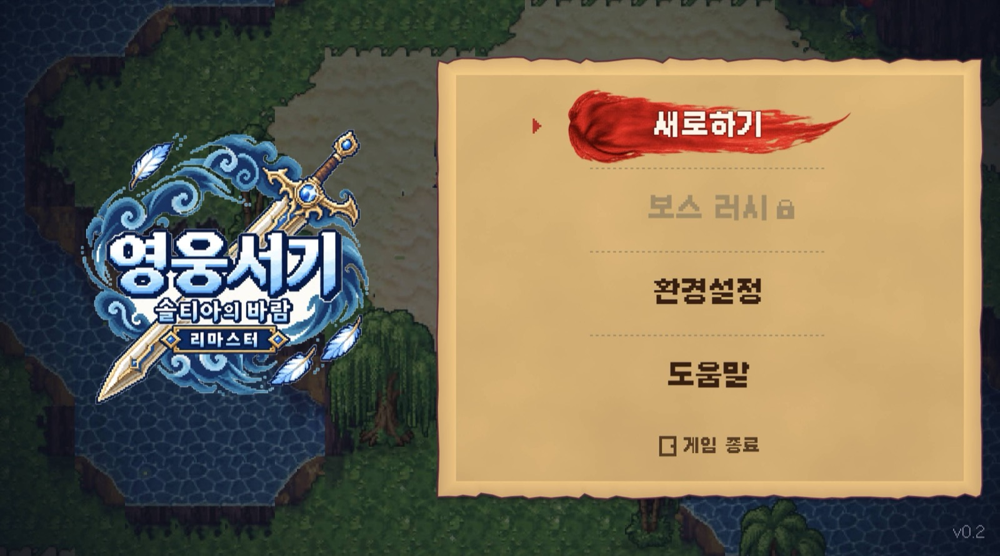
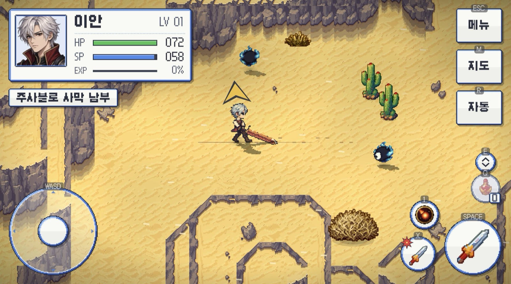

# hero-lord-web

**영웅서기: 솔티아의 바람 리마스터** (fan remaster by Nimdal, shipped as a Godot 4.6
Android APK) running in the browser.

- GitHub Pages: https://lesanf.github.io/hero-lord-web/
- Vercel: deployed from `main` by the Vercel Git integration (`vercel.json`)



## How it works

The APK contains no native game code. `libgodot_android.so` is the stock Godot
4.6 runtime; the game is compiled GDScript (`.gdc`) plus assets stored loose
under `assets/`, already imported for the GL Compatibility renderer. So the port
is a repack, not a rewrite:

```
APK ─unzip─▶ exported Godot project ─pack─▶ hero-lord.pck ─split─▶ 64 MB parts
                     +  web/override.cfg + web/web_shim.gd (web-only autoload)
official Godot 4.6 web template (godot.wasm, nothreads) + web/index.html ─▶ static site
```

| step | file | notes |
|---|---|---|
| inventory | `tools/inventory.py` | what is in the APK, no extraction |
| extract | `tools/extract_project.py` | `assets/` → `build/project/`, drops Android-only files |
| pack | `tools/pack_pck.py` | PCK v2 writer, stdlib only, `tools/test_pack_pck.py` round-trips it |
| assemble | `tools/build_web.py` | pulls the 9.5 MB web template out of the 1.25 GB official tpz with HTTP range requests (sha256 pinned), splits the PCK, writes `index.html` |
| all of it | `./build.sh game.apk` | ~20 s on a laptop |

`web/index.html` fetches the parts in parallel into one buffer, hands it to the
engine with `preloadFile`, and starts with `--main-pack`. Single-threaded
template, so no COOP/COEP headers are needed and any static host works.

## Web-only shim

Nothing in the game is modified. `web/override.cfg` is packed next to
`project.binary` and registers one autoload, `web/web_shim.gd`, which:

- turns on `emulate_touch_from_mouse` (the in-game menus only listen to touch)
- labels every HUD button with its keyboard key
- adds `R` for auto-quest, the one HUD action the game left without a key

| action | keys |
|---|---|
| move | W A S D / arrows |
| attack, talk | Space, Enter |
| strong attack | X |
| skill slots | 1, 3 |
| item | Q |
| cycle slot | E, Tab |
| map | M |
| menu | Esc |
| auto-quest | R (shim) |



## Build it yourself

```sh
./build.sh hero-lord-remaster-20261014-r24.apk          # downloads the template member from GitHub
./build.sh game.apk path/to/web_nothreads_release.zip   # or use a local template zip
python3 -m http.server -d build/web 8765                 # http://127.0.0.1:8765/
```

Requirements: Python 3.8+ and `curl` (for CI). No Godot editor, no Node.

## Docs

- [01 · What is in the APK](docs/01-apk-analysis.md) — manifest, native libs, project layout, formats, with REA evidence ids
- [02 · What the scripts assume](docs/02-scripts-and-web-compat.md) — decompiled platform guards, input model, the shim decision, runtime evidence

## Deploy

- **GitHub Pages**: `.github/workflows/pages.yml` downloads the APK from the
  `apk-r24` release, runs `build.sh`, deploys `build/web/`.
- **Vercel**: `vercel.json` does the same inside Vercel's build. The PCK is
  split because Vercel rejects single files over 100 MB.

## Credits and legal

- Game: 영웅서기 (Heroes Lore) remaster by **Nimdal** (@0xnimdal), a fan game of
  the KTF-era original. All art, audio, scripts and data belong to their
  respective authors and are **not** covered by this repository's license.
- Engine: [Godot Engine](https://godotengine.org) 4.6, MIT.
- Analysis: [REA](https://github.com/morluto/rea) (JADX, CDP) and
  [GDRE Tools](https://github.com/GDRETools/gdsdecomp) for the decompiled scripts.

Tooling and docs here are MIT. The APK is attached to the `apk-r24` release
only as the build input; this repository's git history contains no game content.
