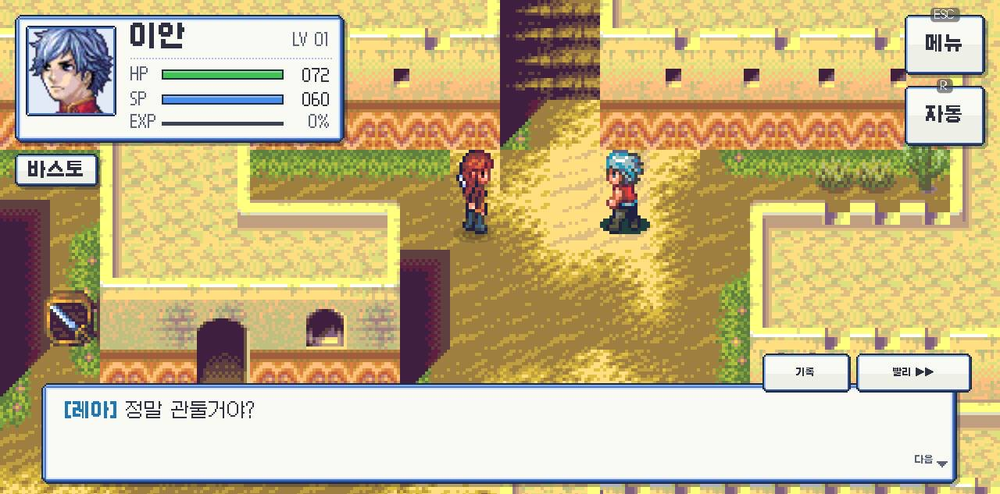
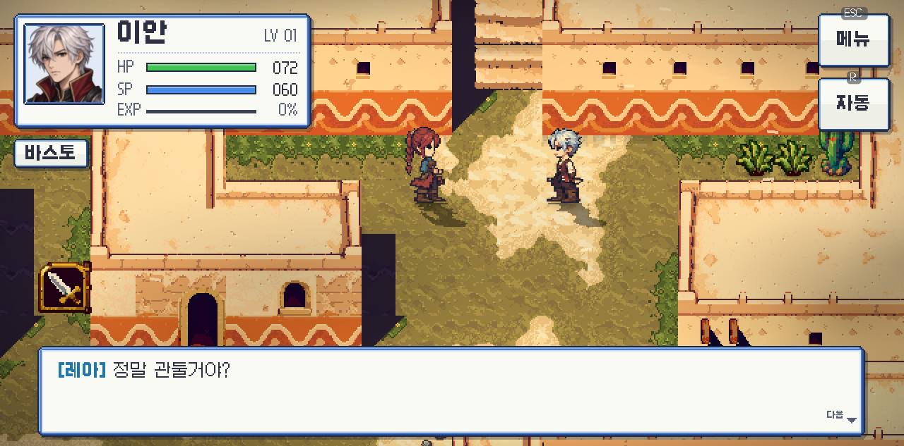

# 02 · What the scripts assume, and what the web build has to fake

All 74 `.gdc` files decompile cleanly with GDRE Tools 2.7.4
(`--recover=<apk> --scripts-only`, bytecode 4.6). 52 are the game, 22 the
`GodotPlayGameServices` addon. `project.binary` decodes to the `project.godot`
quoted at the end. Nothing below was edited; this is read-only analysis.


## Observed: platform guards

Every Android-only call sits behind a feature or singleton check:

| where | guard | behaviour elsewhere |
|---|---|---|
| `scripts/crash_report.gd:37,40,103` | `OS.has_feature("android")` and `Engine.has_singleton("AndroidRuntime")` | prints `CrashReport: 안드로이드가 아님`, no-op |
| `scripts/game.gd:487` | `OS.has_feature("android") and Engine.has_singleton("GodotPlayGameServices")` | cloud saves stay `off`; local `user://saves` only |
| `scripts/cloud_saves_play.gd:28` | `Engine.has_singleton(AUTOLOAD)` | backend never attached |
| `addons/.../godot_play_game_services.gd:40` | `Engine.has_singleton(plugin_name)` | autoload loads, binds nothing |
| `scripts/game.gd:2701` `_display_safe_rect` | `android`/`ios` | returns full viewport |
| `scripts/title_screen.gd:648` `_read_tilt` | `android`/`ios` | falls back to mouse position parallax |
| `scripts/ui_skin.gd:576`, `game.gd:4385,5608` | `android`/`ios` | no haptics, no share sheet |
| `scripts/game.gd:468` | `OS.has_feature("mobile")` | `speed_check` off on desktop/web |

Runtime confirmation (Chrome 155, REA `inspect_web_page` evidence
`ev_1be2fa066c4e42cda8be769e78bb65bcdff8530182b747c1ee67d3b0db2a9b67`),
console in order:

```
Godot Engine v4.6.stable.official.89cea1439 - https://godotengine.org
OpenGL API OpenGL ES 3.0 (WebGL 2.0 (OpenGL ES 3.0 Chromium)) - Compatibility - Using Device: WebKit - WebKit WebGL
Build configuration: Emscripten 4.0.20, single-threaded, no GDExtension support.
CrashReport: 안드로이드가 아님
```

No errors; the title screen renders and reacts to the mouse (hover parallax).

## Observed: input is touch-first

Project setting `input_devices/pointing/emulate_mouse_from_touch=false`.
The engine default for the reverse, `emulate_touch_from_mouse`, is also false.

Handlers that accept **mouse or touch**: the title "press" screen
(`game.gd:4069-4072`, mouse guarded with `device != DEVICE_ID_EMULATION`),
`virtual_joystick.gd:79-103`, `ui/cutscene_viewer.gd:69-70`, `game.gd:1711`.

Handlers that accept **touch only** (`InputEventScreenTouch`/`ScreenDrag`,
routed through `game.gd:4290-4320`):

- `story_menu.gd:1473` `touch()` — menu buttons, list and detail scrolling
- `ui/hero_menu.gd:2278` `touch()` — hero sheet buttons, scrolling, close-on-outside
- `ui/talk_log.gd:106` `touch()` — close key, scrolling
- `game.gd:1954` `_layout_touch` — control layout editor
- `game.gd:4296` minimap close, `touch_buttons`, `_drag_scroll`

There is no `MOUSE_BUTTON_WHEEL` handling anywhere. So with a mouse only:
title works, in-game menus do not.

## Decision: a web-only autoload shim, not a project rebuild

`web/override.cfg` is packed next to `project.binary` and adds one autoload,
`web/web_shim.gd`, which calls `Input.set_emulate_touch_from_mouse(true)`.
Emulated touches carry `DEVICE_ID_EMULATION`, exactly the case the game's
title handler already distinguishes. It also turns off
`debug/file_logging` (IDBFS writes with no reader).

The double path bit immediately: the dialogue's `빨리 ▶▶` is a plain `Button`
connected to `_toggle_fast_forward` (`game.gd:1653`). A left click reached it
twice, once through the GUI (real mouse event) and once through the game's
touch router (`game.gd:4335`, emulated touch), so the toggle cancelled itself;
`다음` advanced two lines per click for the same reason (`_dialogue_clicked`
on the panel plus the router's fallback). Buttons never see GUI input on
Android (`BaseButton` only reacts to mouse events, and there are none there),
so the shim's `_input` marks every real left `InputEventMouseButton` as handled.
Scene nodes' `_input` (virtual joystick, which explicitly skips emulated events,
and the title press screen) run before an autoload's, so they still get the
mouse; only the GUI stage is cut. Wheel and right/middle buttons pass through.

Not done, deliberately:

- Removing the `GodotPlayGameServices` autoload: it is harmless without the
  singleton and `game.gd` reads its state through `has_singleton` first.
- Editing `project.binary`: everything needed is reachable from
  `override.cfg` or at runtime.
- Threads template: needs COOP/COEP; measure first.

## Keyboard on the touch HUD

`game.gd` `_install_actions()` already binds every HUD action to keys; the
screen just never said so. The shim labels each button with its key and adds
the one binding the game lacks, `hero_auto` = R.


| HUD | key(s) | source |
|---|---|---|
| move | W A S D, arrows | `hero_up/down/left/right` |
| attack / talk | Space, Enter | `hero_talk` |
| strong attack | X, 7 | `hero_strong` |
| skill slot 1 / 2 | 1 / 3 | `hero_skill_a` / `hero_skill_b` |
| item | Q, 9 | `hero_item` |
| cycle slot | E, Tab | `hero_cycle` |
| map | M, 0 | `hero_map` |
| menu | Esc | `hero_menu` |
| auto-quest | R | **shim**, presses `auto_button` |

## Audio: stream playback, not Godot's web "sample" mode

Godot 4.3+ defaults the web platform to `audio/general/default_playback_type.web
= Sample`, which hands `AudioStreamWAV` sounds to the Web Audio API directly. The
game builds its own buses in `story_audio.gd` (a `MUSIC_BUS` with
`AudioEffectReverb`, per-voice buses with `AudioEffectPanner`, `set_bus_send`)
and in sample mode the output was silent: measured with an `AnalyserNode` tapped
on `AudioContext.destination`, RMS stayed 0 for both the PCM and the QOA build,
so the codec was not the cause. `override.cfg` sets `default_playback_type.web =
0` (Stream): the C++ mixer renders the buses and effects and the driver pushes
PCM to the browser, as every Godot web game did before 4.3. Sound confirmed by
ear on the rebuilt page.

## Guardian pick cap

`_toggle_guardian` (`game.gd:4906`) flips `guardian_picks[kind]` with no cap,
so a third guardian can be picked; `_guardian_texts` then shows `3 / 2` and
disables 모험 시작 until one is unpicked. The shim connects to each card's
`pressed` after the game's handler and sets `disabled` on the unpicked cards
once two are chosen (the router already skips disabled buttons), clearing it
when a pick is removed or the page is reset.

## Art choice from the landing page

Both art sets are in the pack: the KTF-era originals under `assets/game`,
`assets/world` and the remaster under `assets/modern_pixel`. `world_view.gd`
switches on `modern_art_enabled`; the game persists it as `options.new_art`
(default `true`) in `user://options.json` and applies it in `_load_options()`
(`game.gd:3784`). The game also already reads user args there
(`--unlock-heroes`), so the page passes `-- art=original|remaster` and the shim's
`_init` merges `new_art` into that file before the main scene is instantiated.
Nothing else in the file is touched, so sound/speed/layout settings survive.




## Save data

`user://` → `HeroLordRemaster` custom dir → on web this is IndexedDB
(`/userfs`), persisted by Godot's `persistentPaths` default. Saves survive
reloads in the same browser profile; nothing syncs.

## Recovered `project.godot` (from `project.binary`, GDRE)

```ini
[application]
config/name="영웅서기 | Godot 리마스터 개발판"
config/version="0.2"
run/main_scene="res://scenes/main.tscn"
config/use_custom_user_dir=true
config/custom_user_dir_name="HeroLordRemaster"
config/features=PackedStringArray("4.6", "GL Compatibility")
boot_splash/bg_color=Color(0.968627, 0.952941, 0.917647, 1)
boot_splash/image="res://assets/icon/boot-splash.png"
config/icon="res://assets/icon/icon-192.png"

[autoload]
GodotPlayGameServices="*uid://mvjiglywn6qe"

[debug]
file_logging/enable_file_logging=true

[display]
window/size/viewport_width=1280
window/size/viewport_height=720
window/size/window_width_override=1280
window/size/window_height_override=720
window/handheld/orientation=6
window/size/min_width=480
window/size/min_height=480

[gui]
theme/default_font_multichannel_signed_distance_field=true

[input_devices]
pointing/emulate_mouse_from_touch=false

[rendering]
textures/canvas_textures/default_texture_filter=0
renderer/rendering_method="gl_compatibility"
renderer/rendering_method.mobile="gl_compatibility"
textures/vram_compression/import_etc2_astc=true
environment/defaults/default_clear_color=Color(0.032, 0.046, 0.064, 1)
```
